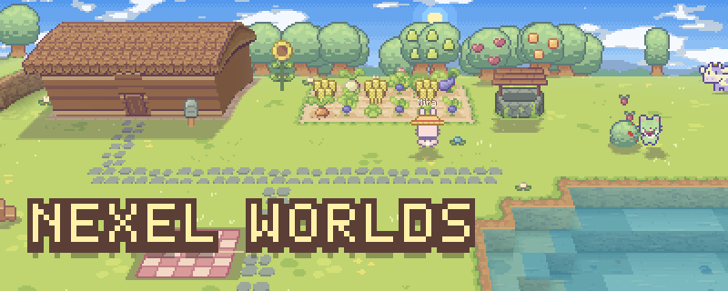
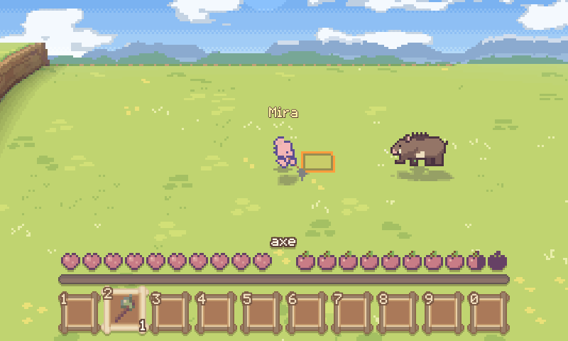
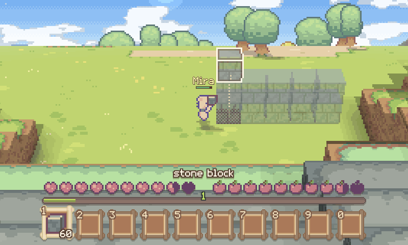
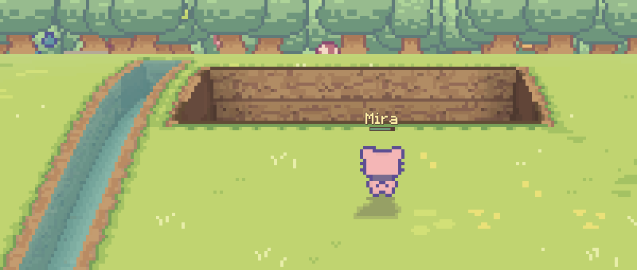
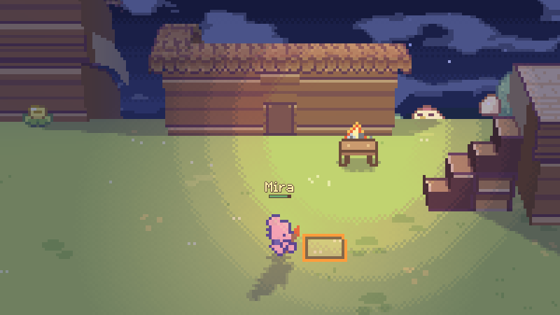
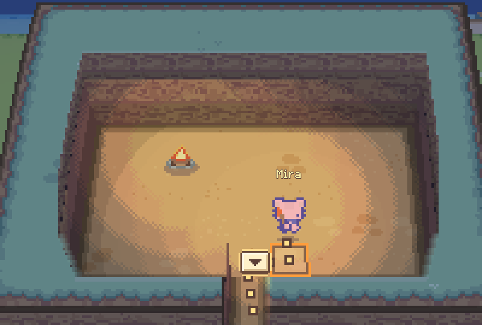
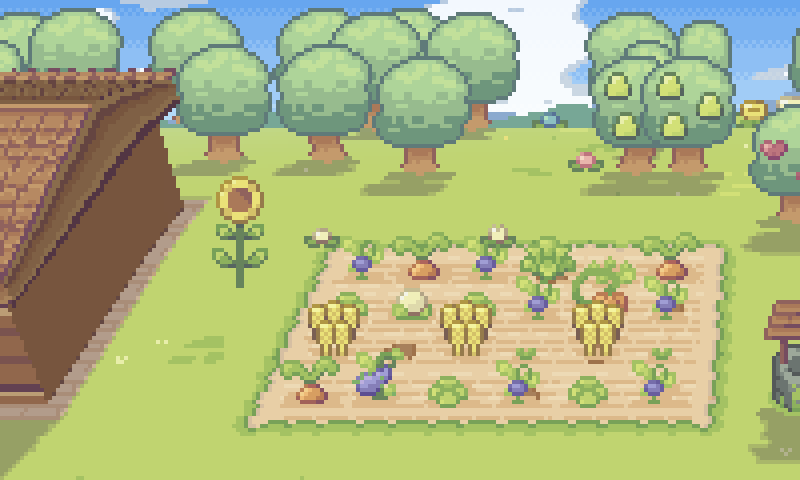

<p align="center">
  
</p>

<p align="center"><b>A cozy top-down sandbox in a world of blocks, shared by people and AI players.</b></p>

<p align="center">
  <a href="https://github.com/sofianedjerbi/nexel-worlds/releases"></a>
  <a href="https://github.com/sofianedjerbi/nexel-worlds/actions/workflows/ci.yml"></a>
  <a href="LICENSE"></a>
</p>

<h3 align="center">
  <a href="https://sofianedjerbi.github.io/nexel-website/play/">Play in your browser</a>
  &nbsp;&middot;&nbsp;
  <a href="https://sofianedjerbi.github.io/nexel-website/play/brain/">Watch an AI player think</a>
  &nbsp;&middot;&nbsp;
  <a href="https://sofianedjerbi.github.io/nexel-website/devlog/">Devlog</a>
</h3>

<br>

<p align="center"></p>
<p align="center"><i>A tusker paws the ground, then charges. Step aside, or stand and fight.</i></p>

<p align="center"></p>
<p align="center"><i>Mark out a wall in build mode and it goes up, block by block.</i></p>

<p align="center"></p>
<p align="center"><i>Cut a river bank and the water runs in.</i></p>

<p align="center"></p>
<p align="center"><i>Night comes. A campfire and a torch keep the dark back.</i></p>

<p align="center"></p>
<p align="center"><i>Dig into a hill: the rock turns see-through so you can see your cave.</i></p>

<p align="center"></p>
<p align="center"><i>Fields, orchards, animals, and the neighbours.</i></p>

## What you can do

- Wander meadows, hills, rivers, gorges and islands, in a world that stays as you left it.
- Dig down into caves and tunnels, or into a hill to make a home.
- Build houses block by block: walls, floors, roofs, stairs, doors.
- Farm, cook and craft your own tools.
- Fight wild beasts, or keep out of their way. They are rare, and they warn you first.
- Swim (slowly), mind what lives in deep water, and watch rivers fill what you dig.
- Get through the night with a fire and a torch.
- Share the world with friends and with AI players who talk, trade and team up.

<br>

<sub>**Run it yourself** (Python 3.14 and [uv](https://docs.astral.sh/uv/)):</sub>

```sh
git clone https://github.com/sofianedjerbi/nexel-worlds && cd nexel-worlds
uv sync --extra art
uv run python tools/install_assets.py ~/Downloads   # the two art packs, see below
uv run nexel-worlds                                 # then open http://127.0.0.1:7777
```

<sub>**Art.** The game is drawn with the premium **Sprout Lands** packs by [Cup Nooble](https://cupnooble.itch.io/). Their licence allows using them in a game but forbids redistributing them, even modified, so they are not in this repository. Buy *Sprout Lands - Sprites - premium pack* and *Sprout Lands - UI Pack - Premium pack*, then install them with `tools/install_assets.py` (the zips, or a folder holding both). Without them the server runs and the page loads, with no land drawn. The enemies and the pixel font were drawn for this game and are included.</sub>

<sub>**Licence.** The code is [MIT](LICENSE). The Sprout Lands art is not included and not covered by it: it is Cup Nooble's, under its own licence. The AI players live in [nexel-agent](https://github.com/sofianedjerbi/nexel-agent). Working on the game: [CONTRIBUTING.md](CONTRIBUTING.md).</sub>
