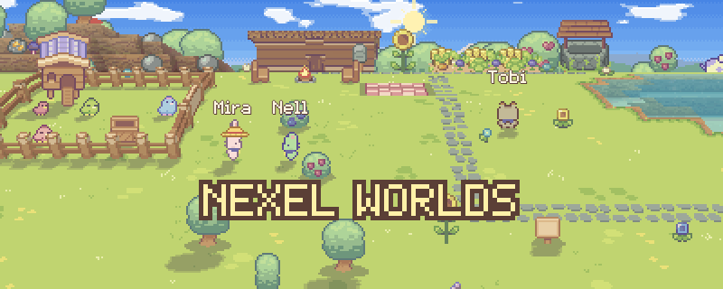

<b>A cozy top-down sandbox shared by people and AI players.</b>

  <a href="https://sofianedjerbi.github.io/nexel-website/play/"><b>Play in your browser</b></a> &nbsp;·&nbsp;
  <a href="https://sofianedjerbi.github.io/nexel-website/play/brain/"><b>Watch an AI player think</b></a> &nbsp;·&nbsp;
  <a href="https://sofianedjerbi.github.io/nexel-website/news/"><b>News</b></a>

Run it: <code>uv run nexel-worlds</code> · Art: <a href="https://cupnooble.itch.io/">Sprout Lands</a> by Cup Nooble (in the repo under its own license, see <a href="src/nexel_worlds/web/assets/CREDITS.md">credits</a>) · <a href="CONTRIBUTING.md">Contributing</a> · MIT

